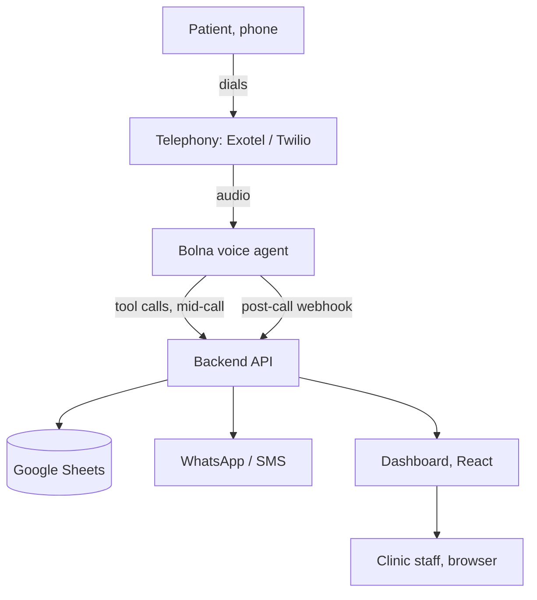

# Architecture

How the whole thing fits together: telephony, the voice agent, the backend, the data, and this
dashboard. This is the plan we are building to.

**The goal in one line:** a patient calls the clinic. The AI answers, books the appointment, and
sends a WhatsApp confirmation. The clinic sees everything on a dashboard.

---

## 1. System overview

```
                         ┌───────────────────────┐
                         │    Patient (phone)    │
                         └───────────┬───────────┘
                                     │  dials the clinic number
                                     ▼
   OUTSIDE WORLD         ┌───────────────────────┐
                         │  Telephony            │
                         │  Exotel / Twilio      │
                         └───────────┬───────────┘
                                     │  audio stream
                                     ▼
   ┌─────────────────────────────────────────────────────────────────┐
   │  VOICE AI                                                       │
   │  Bolna agent: listens, thinks, speaks                           │
   │  Hindi / English / Hinglish                                     │
   └──────┬──────────────────────────────────────────────┬───────────┘
          │  tool calls, mid-call                        │  post-call webhook
          │  "what slots are free?"                      │  transcript + summary
          │  "book this slot"                            │
          ▼                                              ▼
   ┌─────────────────────────────────────────────────────────────────┐
   │  BACKEND API                                                    │
   │  slots, bookings, call logs, clinic settings                    │
   │  The ONLY part that touches data, so there is one source        │
   │  of truth for both the agent and the dashboard.                 │
   └──────┬───────────────────────────┬──────────────────┬───────────┘
          │                           │                  │
          ▼                           ▼                  ▼
   ┌───────────────┐        ┌─────────────────┐   ┌──────────────────────┐
   │ Google Sheets │        │ WhatsApp / SMS  │   │ Dashboard            │
   │ Appointments  │        │ confirmations   │   │ React app, this repo │
   │ Calls         │        └─────────────────┘   └──────────┬───────────┘
   │ Doctors       │                                          │
   │ FAQs, Clinic  │                              ┌───────────┴───────────┐
   └───────────────┘                              │  Clinic staff         │
                                                  │  (browser)            │
                                                  └───────────────────────┘
```

The same diagram as Mermaid, which renders on GitHub:



### How to read it

- **Voice path.** The patient dials the clinic number. The telephony provider passes the call to
  the Bolna agent, which listens, thinks and speaks back in Hindi, English or Hinglish.
- **Backend.** The only part that touches data. Both the voice agent and the dashboard use it, so
  there is one source of truth.
- **Dashboard.** The React app in this repo calls the same backend API to show calls, appointments
  and settings. It ships on mock data and switches to the real API with one environment variable.
- **Data and messaging.** The backend reads and writes Google Sheets, and sends the WhatsApp/SMS
  confirmations.

Everything is two-way in practice, because answers flow back. The arrows show the direction of the
initial request.

---

## 2. One call, step by step (booking)

```
Patient        Bolna agent        Backend          Sheets        WhatsApp
   │                │                │                │              │
   │ 1 ask to book  │                │                │              │
   │───────────────►│                │                │              │
   │                │ 2 check slots  │                │              │
   │                │───────────────►│ 3 read sheet   │              │
   │                │                │───────────────►│              │
   │                │ 4 free times   │◄───────────────│              │
   │                │◄───────────────│                │              │
   │ 5 offers times │                │                │              │
   │◄───────────────│                │                │              │
   │ 6 picks a slot │                │                │              │
   │───────────────►│ 7 book it      │                │              │
   │                │───────────────►│ 8 write row    │              │
   │                │                │───────────────►│              │
   │                │                │ 9 send message │              │
   │                │                │───────────────────────────────►│
   │ 10 confirms    │                │                │              │
   │◄───────────────│                │                │              │
   │                │ 11 send call log                │              │
   │                │───────────────►│ 12 save log    │              │
   │                │                │───────────────►│              │
```

| Steps | What happens |
| --- | --- |
| 1 to 3 | The patient asks to book. The agent calls the backend, which reads the free slots. |
| 4 to 6 | The free times come back. The agent reads them out, the patient picks one. |
| 7 to 8 | The agent asks the backend to book. The backend **re-checks the slot** and writes the row, so a slot can never be double-booked. |
| 9 to 10 | The backend sends the WhatsApp or SMS message. The agent also confirms by voice. |
| 11 to 12 | After the call, Bolna posts the transcript and summary to the backend, which saves the log the dashboard reads. |

Steps 2, 3, 7 and 11 are HTTP calls. Everything else is the agent talking. The exact endpoints and
payloads are in [API-CONTRACT.md](API-CONTRACT.md).

---

## 3. Data: Google Sheet tabs

| Tab | Columns |
| --- | --- |
| `Appointments` | id, patient, phone, doctor, start time, status, booked by (ai/staff), whatsapp sent |
| `Calls` | id, phone, time, duration, language, outcome, summary, transcript, follow-up flag |
| `Doctors` | name, speciality, fee, weekly availability, slot length |
| `FAQs` | question, answer |
| `Clinic` | name, address, greeting, escalation phone number |

The dashboard expects a few fields beyond these columns (intent, resolved, confidence, recording
URL). They are all optional and degrade gracefully. The full column to JSON mapping, including which
fields the backend should synthesise if the agent does not send them, is in
[API-CONTRACT.md](API-CONTRACT.md#google-sheets-mapping).

---

## 4. Backend endpoints at a glance

| Endpoint | Used by | Purpose |
| --- | --- | --- |
| `GET /api/slots?doctorId&date` | Bolna (tool) | Free times for a day |
| `GET /api/slots?doctorId&startsAt` | Dashboard | Is this exact slot free? |
| `POST /api/appointments` | Bolna, dashboard | Book a slot, reject double bookings |
| `PATCH /api/appointments/:id` | Bolna, dashboard | Reschedule, cancel, complete |
| `GET /api/faqs`, `GET /api/clinic` | Bolna (tools) | Answer questions from clinic data |
| `POST /api/calls/webhook` | Bolna, after the call | Save transcript, summary, outcome |
| `GET /api/calls`, `GET /api/appointments` | Dashboard | Fill tables and charts |
| `PUT /api/clinic`, `/api/doctors`, `/api/knowledge` | Dashboard | Edit what the AI knows |

The complete contract, with request and response bodies and error codes, is in
[API-CONTRACT.md](API-CONTRACT.md).

---

## 5. Repo layout

```
.
├── src/                 the dashboard (React + TypeScript + Vite)
│   ├── lib/
│   │   ├── api.ts           THE CONTRACT: every call the UI makes, mock or live
│   │   ├── api.mock.ts      the demo implementation
│   │   ├── http.ts          fetch wrapper: base URL, auth header, error handling
│   │   └── config.ts        reads VITE_API_BASE_URL
│   └── pages/           Landing, Overview, Calls, Appointments, Agent, Outbound, Settings
├── server/              a working reference backend (zero dependencies)
│   ├── index.mjs            implements the whole contract
│   ├── data.mjs             seed data, shaped like the Sheet tabs
│   └── test.mjs             34 assertions covering the contract
└── docs/                this folder
```

---

## 6. Build order (this avoids blockers)

1. **Day 1: start the phone number setup.** Verification can take days, and nothing else is
   blocked by it.
2. **Build the backend and the Sheet first.** The agent calls them as tools, so they must exist
   before the agent can do anything real.
3. **Build the frontend on mock data in parallel**, then point it at the real API. That is one
   environment variable, not a rewrite.
4. **Add WhatsApp last, with SMS as the fallback.**
5. **Host the backend on HTTPS** (Render or Railway free tier). Bolna cannot reach `localhost`, so
   use a tunnel such as ngrok while developing.

---

## 7. Fifteen day plan

| Days | Voice and prompt | Backend and data | Frontend and demo |
| --- | --- | --- | --- |
| 1 to 3 | Create the Bolna agent, the FAQ flow, the greeting | Sheet tabs, API skeleton, deploy | Landing and Overview on mock data |
| 4 to 8 | Booking flow with tool calls | `/slots`, `/appointments`, the double-booking check | Calls and Appointments pages |
| 9 to 11 | Hindi and Hinglish tuning, human handoff | WhatsApp/SMS sending, the call webhook | Settings page, connect the real API |
| 12 to 13 | Edge cases: emergencies, unclear speech | Call logs, error handling | Polish, charts, dark mode |
| 14 to 15 | Real-call testing with friends | Bug fixes | Demo video, submission form |

**Definition of done.** Call the number, talk in Hindi or English, get an appointment booked in the
Sheet, receive a WhatsApp message, and see the call on the dashboard.

---

## 8. Risks and fixes

| Risk | What we do |
| --- | --- |
| The AI mishears Indian names | Ask the patient to confirm the name and the time, and keep sentences short |
| Phone verification is slow | Start it on day 1 |
| WhatsApp approval is slow | Use SMS as a backup channel |
| The AI gives unsafe advice | Strict prompt: no medical advice, answer only from clinic data, emergencies go to a human |
| The live demo fails | Record a backup demo video early |
| Too much scope | Finish the must-haves first, cut the nice-to-haves |

Two more that we have already hit while building the dashboard:

| Risk | What we do |
| --- | --- |
| The agent is slow mid-call because the backend is slow | Keep `/slots` under 300 ms. See the latency budget in [VOICE-AGENT.md](VOICE-AGENT.md#4-latency-budget). |
| The dashboard and the Sheet disagree | The backend is the only writer. The dashboard never talks to Sheets directly. |
